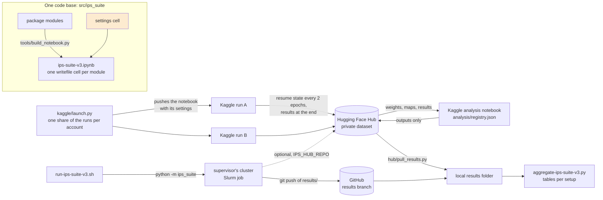
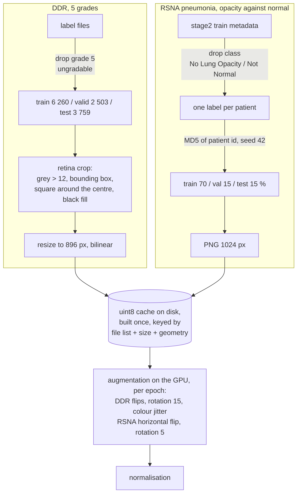
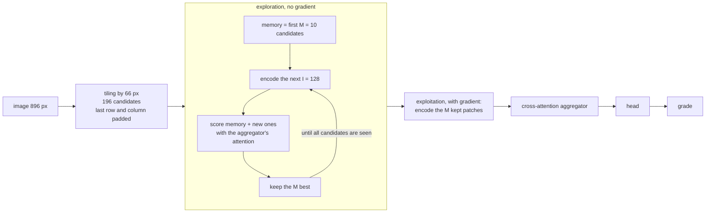
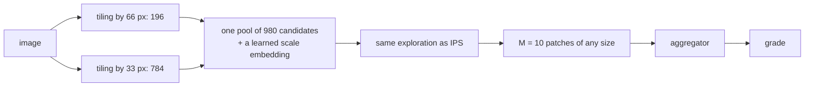
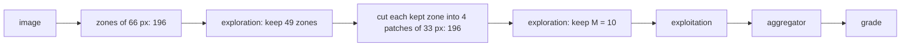
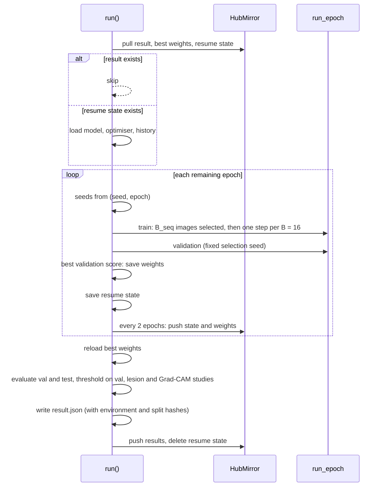

# Architecture of ips-suite-v3

What the code does, drawn, so that every design choice is visible without
reading the implementation. Each choice and its reason is listed in
[DECISIONS.md](DECISIONS.md); how to run it is in [RUNNING.md](RUNNING.md).
Diagrams are Mermaid: they render on GitHub, in VS Code (Markdown preview
with a Mermaid extension) and in Obsidian.

Written on 2026-11-26 from the code at the commit that adds this file.
File names refer to the package `src/ips_suite/` (the notebook is generated from it).

## 1. The whole system

The same package runs everywhere (through the notebook on Kaggle, directly on the cluster); only environment variables change
(`IPS_RUNS`, `IPS_EPOCHS`, data folders, `IPS_HUB_REPO`). The cluster keeps its
own way of running (Slurm script, git push of results); the Hub is optional
there.

## 2. Data (`data/datasets.py`)

The images of each split are identified by a hash (`split_hash`, stored in
every result): two runs with the same hash used exactly the same images.

## 3. The models (`models/`)

All patch models share one encoder (ResNet-18, all four blocks, ImageNet
weights, average pooling to 512 values), one projector (LayerNorm, linear to
D = 512, BatchNorm, ReLU) and one aggregator (cross-attention with one learned
query, then an MLP), followed by a linear head.

### IPS: select without gradients, train on the selection

Memory depends on M and I, not on the image size: only M patches carry
gradients.

### MS-IPS: two patch sizes compete for the same M places

The encoder's average pooling gives 512 values whatever the patch size, so
patches of both sizes are comparable after the projector.

### H-MS-IPS: coarse zones first, small patches inside them

On RSNA: zones of 300 px (16), keep 4, cut into 150 px patches (16), keep 10.

### Reference models

| Model                      | What it does                                                | Why it is here                                   |
| -------------------------- | ----------------------------------------------------------- | ------------------------------------------------ |
| Full image (`BaselineNet`) | ResNet-18 on the whole image, end to end                    | the reference every patch model is compared with |
| Attention MIL (`MILNet`)   | every patch encoded with gradients, gated attention pooling | what selection saves memory against              |
| `_sa` variants             | self-attention aggregator instead of cross-attention        | ablation of the aggregator                       |
| `_rand` variants           | random selection instead of learned                         | ablation of the selection                        |

## 4. One training run (`training/epoch.py`, `training/runner.py`)

Optimiser AdamW (peak lr 1e-4, weight decay 0.1), linear warm-up over 10
epochs then cosine decay to 1/1000 of the peak, 50 epochs (schedule of the
original IPS code, `training/schedule.py`); loss = negative log-likelihood of the softmax. The epoch
kept is the best on validation; the test set is used once, at the end.

## 5. Where the files go

| Folder                                                | Content                                         | Shared         |
| ----------------------------------------------------- | ----------------------------------------------- | -------------- |
| `results/ips-suite-v3/<configuration>/experiments/`   | `<run>_result.json`, lesion and Grad-CAM tables | yes (git, Hub) |
| `results/.../history/`                                | per-epoch history, CO2                          | yes            |
| `results/.../predictions/`                            | per-image probabilities, val and test           | yes            |
| `artifacts/ips-suite-v3/<configuration>/checkpoints/` | best weights, resume state                      | Hub only       |
| `artifacts/.../saliency/`                             | Grad-CAM maps                                   | Hub only       |
| `cache/`                                              | decoded images                                  | never          |

## 6. Reproducibility across machines

| Same everywhere                                   | Differs with the machine                           |
| ------------------------------------------------- | -------------------------------------------------- |
| code (commit stored in `environment.code_commit`) | time per epoch, total time                         |
| images of each split (`data.split_hash`)          | peak memory by a few percent (allocator)           |
| seeds, and every random draw per epoch            | the last digits of the scores (GPU kernels differ) |
| hyper-parameters (`config`)                       | CO2 estimate                                       |

`IPS_DETERMINISTIC=1` makes two runs on the same GPU type give the same
numbers, at some cost in speed. Across GPU types the scores stay within
run-to-run noise; the aggregation script lists the setup of every run and
warns when a table mixes setups or splits.
